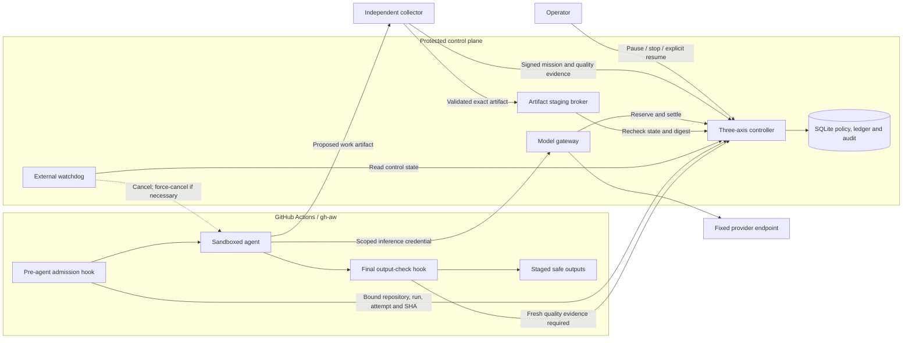
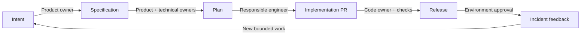
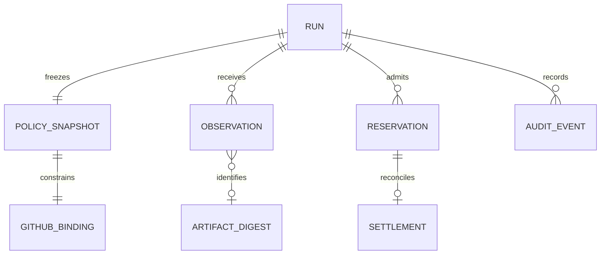

# Enterprise Agentic SDLC Kit

**Keep an agent on mission, producing acceptable work, and within budget while it runs.**
Built on [GitHub Agentic Workflows](https://github.com/github/gh-aw), with an independent controller
that can deny the next model call, withhold an output, pause a run, or request cancellation.

[](https://github.com/dmgrok/enterprise-agentic-sdlc/actions/workflows/ci.yml)

**Integration prototype.** The governed recipe compiles against `gh-aw v0.92.0`. Its admission hooks,
reservation-aware model gateway, independent artifact collector and staging broker have executable fixture tests.
A paid model run and an end-to-end deployment on GitHub have **not** been verified. The installable recipe keeps safe outputs
staged. This is not a production release or a compliance certification.

## The three operating axes

| Axis | Question | Signals and intervention |
| --- | --- | --- |
| Mission | Is the agent doing the approved job? | Bind objective and revision; restrict tools and paths; stop on scope escape; pause on stalled progress |
| Quality | Is the result acceptable? | Require fresh named checks; bind artifact checks to a digest; pause on failure; stop at the repair ceiling |
| Spend | Are cost and consumption under control? | Reserve maximum cost before a call; settle usage afterward; enforce cumulative and rolling limits |

**Continue = mission healthy AND quality healthy AND spend healthy.** Missing critical evidence pauses the run.
Schema checks establish structure and scope. Human acceptance and task-specific evaluations still establish whether
an artifact solves the original problem.

## Architecture and trust boundaries



The agent credential can request inference and check admission for **one enrolled run**. It cannot create policy,
sign telemetry, resume itself or stage writes. Collector, operator and writer credentials are separate.
The real provider key lives in the gateway. Deployment must keep the control database, signing key and those
privileged credentials outside the agent's filesystem and network authority.

The diagram describes the integration components. The repository supplies their implementation and a compiled
recipe; hosting, TLS, secret provisioning, collectors and the external watchdog remain deployment work.

## Delivery lifecycle



Agents propose artifacts; people decide. Approval authority comes from trusted platform records, never an
`approved: true` field. The offline evaluator covers all six contracts. The packaged workflows currently draft
**intent only**; the other five agent workflows and the live lifecycle-approval adapter remain on the
[implementation roadmap](docs/implementation.md).

## Follow one model call

```mermaid
sequenceDiagram
    participant A as gh-aw agent
    participant G as Model gateway
    participant C as Controller
    participant P as Provider
    A->>G: Chat request with run-scoped token
    G->>C: Check health; reserve worst-case cost
    alt Any axis unhealthy or insufficient budget
        C-->>G: Denied; persist pause or stop
        G-->>A: Request rejected before provider call
    else Admission succeeds
        C-->>G: Reservation recorded
        G->>P: Fixed model; bounded output; controller-owned credential
        P-->>G: Completion and usage
        G->>C: Settle actual charge
        alt Run remains healthy
            G-->>A: Completion, or buffered SSE
        else Stop or reconciliation required
            G-->>A: Response withheld; outputs remain blocked
        end
    end
```

Budget admission counts **settled spend + every outstanding maximum reservation + the proposed request**.
Retries keep their accumulated spend. Unknown provider usage retains the reservation and pauses the run.
The gateway reserves the configured model context bound and requested output bound, rather than guessing token
counts from character length. Rates and token bounds must come from the operator's actual provider contract.
The example rates used by tests are synthetic.

Supported proxy surface: OpenAI-compatible, text/tool chat completions for one explicitly priced model.
Streaming clients receive buffered SSE after settlement. Responses API, multimodal requests, other currencies,
provider-specific fees and live streaming are not implemented. Runner and storage charges need separate accounting.

## Pause, stop and resume

```mermaid
stateDiagram-v2
    [*] --> Paused: Enroll immutable policy
    Paused --> Running: Fresh healthy evidence and explicit operator resume
    Running --> Paused: Failed check, stale telemetry or burn-rate limit
    Running --> Stopped: Scope escape, budget ceiling, repair ceiling or operator stop
    Paused --> Stopped: Operator stop or hard ceiling
    Running --> Paused: GitHub execution completed; await final gate
    Stopped --> [*]: Terminal for this enrolled run
```



Pause denies new calls and outputs. The local supervisor terminates the current process; the GitHub watchdog
requests cancellation of the attempt. Resume is a new explicit execution decision, not suspension of an in-flight
provider request. Completed writes and consumed tokens cannot be undone. A cancelled GitHub attempt needs an
explicitly authorised, budget-preserving handoff; that cross-attempt workflow is not implemented yet.

## Quick start without a model credential

Python 3.10 or later on Linux or macOS:

```sh
python3 -m venv .venv
.venv/bin/python -m pip install -r requirements.txt
.venv/bin/python -m unittest discover -v
.venv/bin/python -m kit.profile .
.venv/bin/python examples/control_demo.py --output reports/control-demo.json
.venv/bin/python examples/http_demo.py
```

The local demo stops real child processes. The HTTP demo exercises role separation, admission, a fake provider,
usage settlement, independent artifact checks, staging and a denied call after stop. Tests include schema and
negative-path coverage, concurrent reservations, stale evidence, all three axis breaches and mocked cancellation.
No paid provider is contacted by these commands.

## Machine-readable contracts

All schemas use JSON Schema Draft 2020-12 and are validated by tests. They describe candidate `0.1` contracts.

| Contract | Purpose | Source |
| --- | --- | --- |
| Control policy | Immutable objective, revision, tools, paths, operators and thresholds | [control-policy.schema.json](schemas/control-policy.schema.json) |
| GitHub binding | Repository, numeric run ID, attempt and exact revision | [binding.schema.json](schemas/binding.schema.json) |
| Telemetry | Signed three-axis observation, monotonic sequence, timestamp and artifact digest | [telemetry.schema.json](schemas/telemetry.schema.json) |
| Intent | Proposed artifact; excludes approval-granting fields | [intent.schema.json](schemas/intent.schema.json) |
| Gate evidence | Offline lifecycle-validator report, including checks and corrective actions | [evidence.schema.json](schemas/evidence.schema.json) |

An observation before signing looks like this. These hashes and timestamp are illustrative; use the actual enrolled
policy digest, subject SHA and current epoch time when sending evidence.

```json
{
  "run_id": "WORK-1",
  "revision": "aaaaaaaaaaaaaaaaaaaaaaaaaaaaaaaaaaaaaaaa",
  "policy_digest": "bbbbbbbbbbbbbbbbbbbbbbbbbbbbbbbbbbbbbbbbbbbbbbbbbbbbbbbbbbbbbbbb",
  "sequence": 3,
  "observed_at": 1792288800,
  "mission": {
    "objective_id": "draft-intent",
    "scope_violation": false,
    "progress": "advancing"
  },
  "quality": {
    "checks": {"scope": "pass", "artifact-schema": "pass"},
    "repair_attempts": 0,
    "artifact_digest": "cccccccccccccccccccccccccccccccccccccccccccccccccccccccccccccccc"
  },
  "spend": {"accounting": "reservation-ledger", "coverage": "complete"}
}
```

The collector wraps this as `{ "event": EVENT, "signature": HMAC_SHA256 }`. The signature covers canonical JSON.
It authenticates a trusted collector, not the truth of an agent's own statements. The independent collector checks
actual files and the broker recomputes the artifact digest before staging.



This is the logical data model. SQLite stores run snapshots as JSON plus an append-only application audit table;
it does not create a separate SQL table for every entity in the diagram.

## Connect the governed gh-aw recipe

The package installs only the governed recipe. The original unconnected recipe is retained as a test fixture:

| Recipe | Execution |
| --- | --- |
| `fixtures/gh-aw/draft-intent.md` | Regression fixture only; not installed by `aw.yml` |
| `governed-intent.md` | Protected start approval, external admission, BYOK gateway, artifact export and final output check |

1. Deploy the controller behind HTTPS and provision separate scoped credentials. Follow the
   [integration deployment guide](docs/integration.md). The built-in HTTP server binds loopback for a TLS reverse proxy.
2. Choose a fixed provider model and verified pricing/token bounds. Set the real provider credential only on the server.
3. Install into a fixture repository using a reviewed commit SHA:

   ```sh
   gh aw add dmgrok/enterprise-agentic-sdlc@COMMIT_SHA
   ```

4. Configure the governed source in this package, then compile it with the pinned compiler before distributing the
   resulting source/lock pair to the consumer:

   ```sh
   .venv/bin/python scripts/configure_governed.py --controller-url https://YOUR_CONTROLLER_HOST --model YOUR_MODEL
   .venv/bin/python scripts/compile.py --compiler /absolute/path/to/gh-aw
   ```

   The checked-in controller address uses the reserved `.invalid` domain and cannot contact a real service.
5. Configure `KIT_AGENT_TOKEN` on the consumer and a protected Environment named `kit-agent-start`. Dispatch with a
   controller run ID. While GitHub waits for that approval, enroll the exact repository/run/attempt/SHA on the controller,
   start independent readiness observations and explicitly resume. Then approve the Environment.
6. Keep collector heartbeats fresh during execution. Download the exported `kit-intent-RUN_ID-ATTEMPT` work artifact
   using a trusted, provenance-verifying collector. Validate the actual files, submit signed digest-bound results and
   retain human acceptance as a separate decision. The final hook denies execution without independent artifact evidence.

The installable recipe retains staged safe outputs. The final HTTP check is a snapshot and cannot make a later GitHub write
atomic with controller state. The supplied writer broker stages artifacts under the controller's authority; a
production GitHub writer must use an equivalent atomic/reconciled authority path before real writes are enabled.
A full consumer installation and paid Copilot BYOK run still require a deployment trial.

## API and operator reference

| Endpoint | Credential role | Effect |
| --- | --- | --- |
| `POST /runs/{id}` | Operator | Enroll immutable policy |
| `POST /runs/{id}/telemetry` | Collector | Accept signed evidence |
| `POST /runs/{id}/commands` | Operator | Pause, stop or explicit resume |
| `POST /runs/{id}/admission` | Agent | Check current health and GitHub binding |
| `POST /v1/chat/completions` | Agent | Reserve, call fixed provider, settle |
| `POST /runs/{id}/output-check` | Agent | Require healthy state and independent artifact digest |
| `POST /runs/{id}/stage` | Writer | Validate and stage the exact digest-bound artifact |
| `GET /runs/{id}` | Any scoped role | Inspect state |
| `GET /runs/{id}/audit` | Operator | Read audit history |

Every credential is scoped to one enrolled run. The service stores token hashes; the collector HMAC key and
upstream key are provisioned separately. HTTP logs do not include request bodies, provider responses or credentials.
The prototype requires a protected reverse proxy for TLS, rate/connection limits and production authentication.

- [Deploy and operate the HTTP integration](docs/integration.md)
- [Runtime policy, reservations and intervention details](docs/runtime-controls.md)
- [Remaining enterprise release criteria](docs/implementation.md)
- [Contributing and verification](CONTRIBUTING.md)

## Reproduce the compiled recipe

Compiler: **gh-aw v0.92.0**. Actions dependency: **`458b269006dcf88e3b5496b6fbecabe4b9a0f954`**.
Download the official [release binary](https://github.com/github/gh-aw/releases/tag/v0.92.0), verify its checksum,
and run:

```sh
.venv/bin/python scripts/compile.py --compiler /absolute/path/to/gh-aw --check
```

Compilation occurs in a temporary consumer repository. CI runs deterministic tests and fixture demonstrations;
it does not invoke an agent. Repository protections and the remaining six-gate enforcement path need separate
configuration and validation.

## License

MIT, see [LICENSE](LICENSE). This is an independent project, not endorsed by GitHub.
